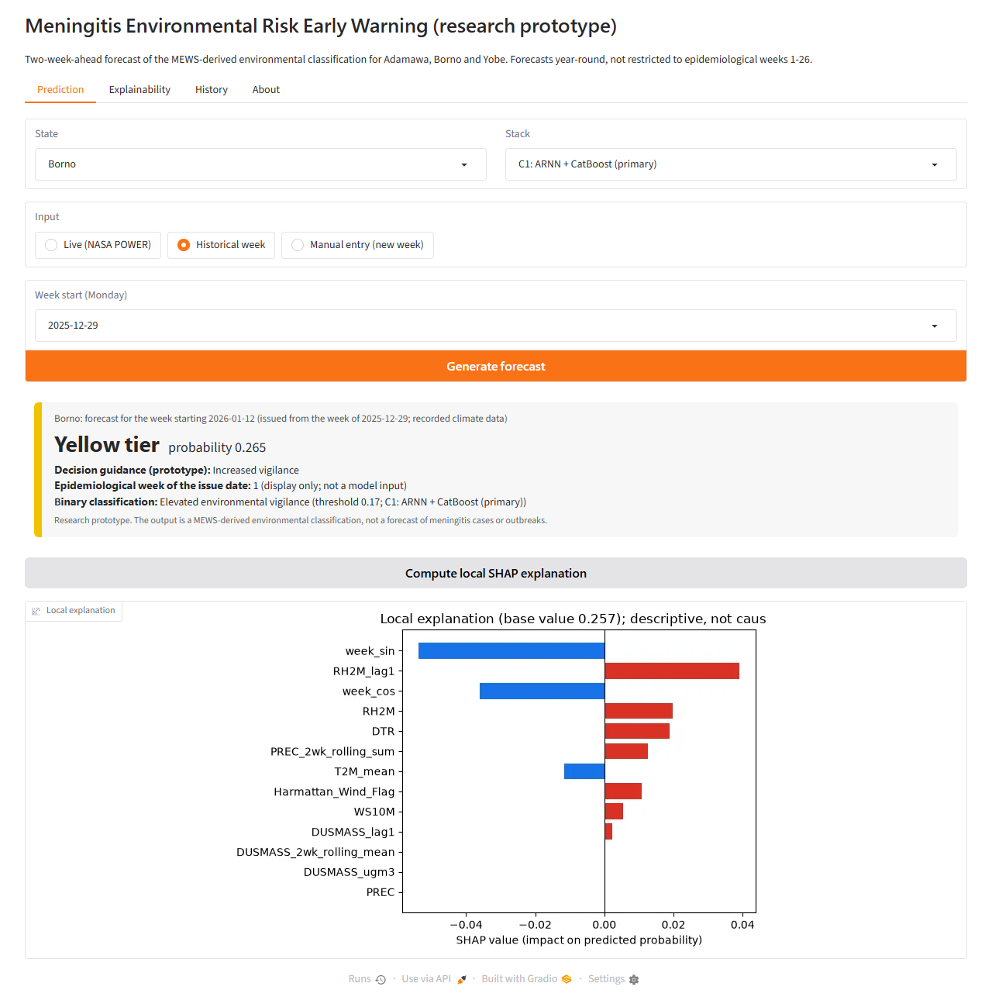
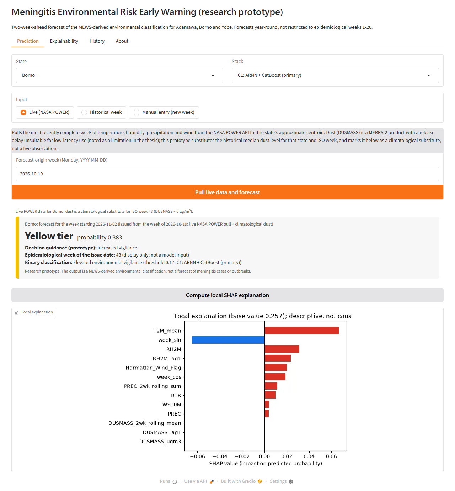
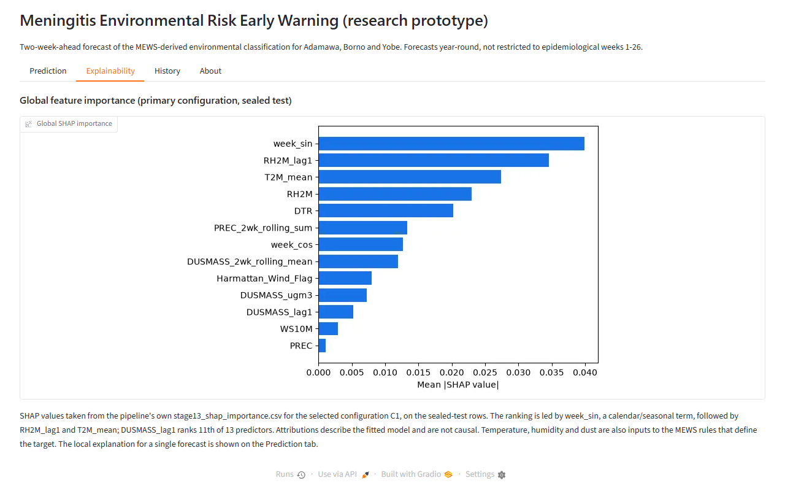
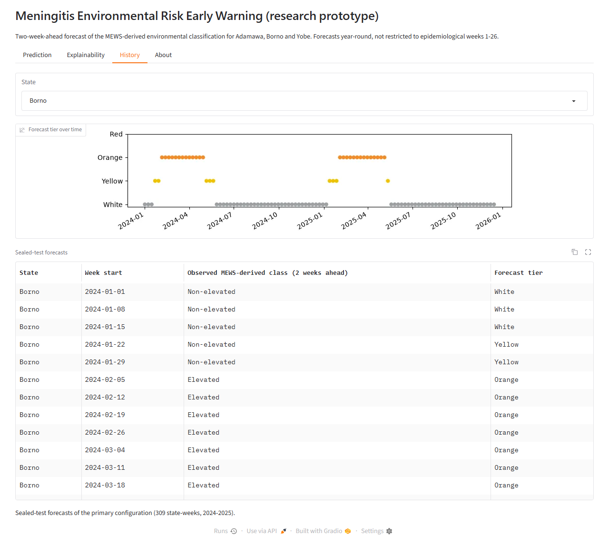
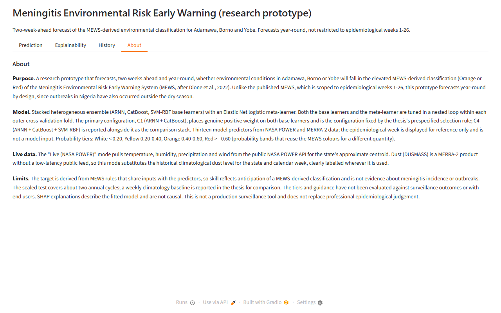

# Meningitis Environmental Risk Early Warning — research prototype

An interactive web app, hosted on Render, for the stacked heterogeneous ensemble
(ARNN + CatBoost, with ARNN + CatBoost + SVM-RBF reported alongside it) from the thesis *A Climate-Based Machine
Learning Framework for Forecasting Meningitis Environmental Risk in Northeast
Nigeria: A Stacked Heterogeneous Ensemble Learning Approach* (Andrew Apolmi, AUN).

It forecasts, two weeks ahead and year-round, whether environmental conditions in
Adamawa, Borno or Yobe fall in the elevated MEWS-derived classification (Orange/Red).
**It does not forecast meningitis cases or outbreaks** — the target is a rule-based
function of climate and dust, not disease incidence.

## Live demo

**▶ Try it: [meningitis-ew.onrender.com](https://meningitis-ew.onrender.com)**

Hosted on Render's free plan. If nobody has used it for 15 minutes it goes to sleep,
and the first visit after that takes about a minute to wake it.

[](docs/demo.mp4)

*30-second walkthrough: [download the MP4](docs/demo.mp4).*

## Screenshots

**Prediction: historical week, with a local SHAP explanation**



**Prediction: live NASA POWER pull**



| Explainability (global SHAP) | History (sealed-test forecasts) |
|---|---|
|  |  |



## Running locally

```bash
python -m venv .venv && source .venv/bin/activate
pip install -r requirements.txt
python app.py
```

Then open `http://127.0.0.1:7860` in your browser. (The interface is built with the
Gradio Python library, which is installed from `requirements.txt`.)

## Data and model files (`data/`)

Copied from the final (v6) pipeline run's app bundle:

- `final_models.pkl` — the fitted base learners, scalers and per-stack meta-learners,
  thresholds and feature lists (13 model predictors; `epi_week` is display-only).
- `climate_weekly.csv` — weekly NASA POWER / MERRA-2 climate history by state
  (2018–2024), used by the "Historical week" input mode.
- `background.csv` — a background sample for the SHAP `KernelExplainer`.
- `shap_importance.csv` — the primary configuration's global SHAP ranking
  (sealed test).
- `stage20_tier_predictions.csv`, `stage20_tier_decision_map.csv` — sealed-test
  forecast history and the tier-to-decision-guidance mapping, used by the
  "History" tab.

**Do not retrain or re-pickle these files with a different scikit-learn/CatBoost
version** — `requirements.txt` is pinned to the exact versions the pipeline used
(see `run_manifest.json` in the pipeline output), or the pickled models may fail to
load or load with inconsistent internals.

## Live data mode

The "Live (NASA POWER)" input on the Prediction tab calls the public
[NASA POWER](https://power.larc.nasa.gov/) daily point API for temperature,
humidity, precipitation and wind, at an approximate centroid for the selected
state. Dust (`DUSMASS`) is a MERRA-2 product with a release delay unsuitable for a
low-latency public pull, so this mode substitutes the historical climatological
dust level for the state and calendar week — this is clearly labelled in the app,
not presented as a live observation. This mirrors a limitation already noted in the
thesis (Section 5.9 / Major 8): a genuinely live MERRA-2 feed would need a different,
faster-release data source.

This call needs outbound internet access, so it only works where the app is
actually deployed — it cannot be exercised from a network-restricted sandbox.

## Deployment (Render, free plan)

The live demo runs on [Render](https://render.com) as a free Docker web service
built from this repo's `Dockerfile`, which installs `libgomp1` (needed by CatBoost),
precompiles bytecode and builds the matplotlib font cache so the app starts quickly
on the free instance's 0.1 CPU. The service was created from the public repo URL, so new
commits are deployed with `render deploys create <service-id>` (or **Manual Deploy** in the
dashboard). Connect Render's GitHub app to the repo if you want every push to redeploy.

To deploy your own copy, either use the included `render.yaml` blueprint
(Render dashboard → **New → Blueprint** → pick this repo), or use the
[Render CLI](https://render.com/docs/cli):

```bash
render login
render services create --name meningitis-ew --type web_service \
  --repo https://github.com/<you>/meningitis-ew-streamlit --branch main \
  --runtime docker --plan free --health-check-path / --env-var PORT=10000
```

No secrets or API keys are needed, since the NASA POWER API is public. The app also runs
anywhere that can run the Docker image or `python app.py`.

## Limits

The sealed test covers about two annual cycles; a weekly climatology baseline is
reported in the thesis for comparison. SHAP explanations describe the fitted model
and are not causal. This is a research prototype, not a production surveillance
tool, and does not replace professional epidemiological judgement.
